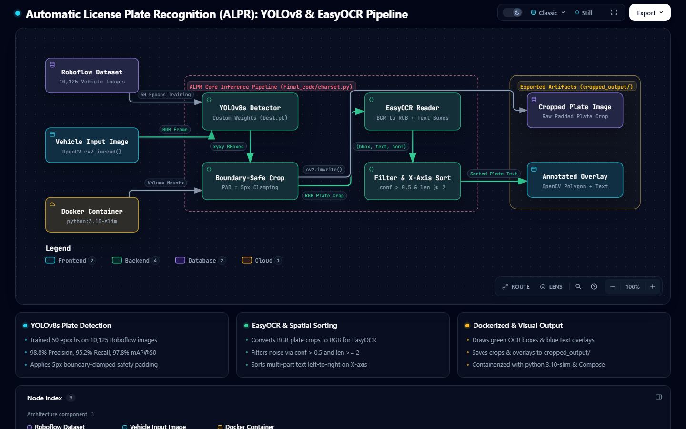
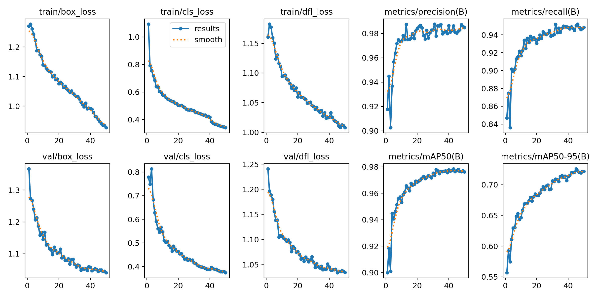

# 🚘 Automatic License Plate Recognition (ALPR) using YOLOv8 & EasyOCR

> **Problem:** Traditional license plate recognition systems struggle with varying lighting, skewed camera angles, multi-vehicle frames, and fragmented OCR detections—often clipping edge characters or scrambling multi-part plate numbers, while complex OpenCV/PyTorch/EasyOCR dependency chains break across environments.
>
> **Solution:** A fully containerized, production-grade Computer Vision & OCR pipeline combining a custom-trained **YOLOv8s** object detector (`97.8% mAP@50`) with **EasyOCR**, boundary-safe spatial padding, confidence filtering, and left-to-right coordinate sorting to accurately detect, crop, read, and annotate vehicle license plates.

[]()
[]()
[]()
[]()
[]()

---

## 📊 The Problem (The Challenge in ALPR)

- **Multi-Scale & Multi-Vehicle Detection:** Real-world traffic scenes often contain multiple vehicles at varying distances and angles, requiring high-precision bounding box localization before character recognition can occur.
- **Tight Bounding Box Clipping:** Object detectors frequently predict tight bounding boxes around license plates, clipping the first or last character and degrading downstream OCR accuracy.
- **Noisy OCR & False Positives:** Bolts, plate frames, stickers, and shadows are often misread by OCR engines as single-character noise with low confidence.
- **Unordered Multi-Segment Text:** When a license plate contains spaces, dashes, or stacked segments, OCR engines may return text boxes out of reading order.

## 💡 The Solution (End-to-End Workflow)

This project implements a robust 5-stage **Automatic License Plate Recognition (ALPR / ANPR)** pipeline inside `Final_code/charset.py`:

1. **Vehicle Plate Detection (YOLOv8):** Custom-trained YOLOv8 weights (`best.pt`) localize one or more license plates in an input image.
2. **Image Cropping with Safety Padding:** Each detected bounding box is expanded by a `5px` safety margin (`PAD = 5`) clamped to image boundaries so characters near plate edges are never cut off.
3. **Optical Character Recognition (EasyOCR):** Cropped plates are converted from BGR to RGB and passed to an English EasyOCR reader (`easyocr.Reader(['en'])`).
4. **Confidence & Length Filtering + Spatial Sorting:** Detections are filtered (`confidence > 0.5` and `len(text) >= 2`) to eliminate visual artifacts, then sorted spatially from left to right along the X-axis (`r[0][0][0]`).
5. **Visual Overlay Generation:** OpenCV renders polygon bounding boxes and recognized alphanumeric strings onto the cropped plate images and exports both raw crops and annotated overlays to `cropped_output/`.

---

## 🏗️ Architecture


*(Visual representation of the Roboflow Dataset, YOLOv8s Detector, Boundary-Safe Cropper, EasyOCR Reader, X-Axis Spatial Sorter, Docker Runtime, and Exported Artifacts — Interactive viewer available at `docs/architecture.html`.)*

---

## 🧠 How the Pipeline Works (Code Explanation)

The core inference logic resides in `Final_code/charset.py` within `recognize_plates_from_image()`:

| Stage | Code Implementation | Technical Purpose |
| :--- | :--- | :--- |
| **1. YOLOv8 Detection** | `results = model(image_path)`<br>`for idx, box in enumerate(results[0].boxes):` | Runs forward inference on the input image and iterates over every detected license plate bounding box (`box.xyxy[0]`). |
| **2. Safety Padding (`PAD = 5`)** | `x1 = max(0, x1 - PAD)`<br>`y1 = max(0, y1 - PAD)`<br>`x2 = min(w, x2 + PAD)`<br>`y2 = min(h, y2 + PAD)` | Expands the tight YOLO bounding box by 5 pixels in all directions while clamping coordinates to `[0, w]` and `[0, h]`. Prevents edge characters from being clipped and gives EasyOCR contextual margin around glyphs. |
| **3. Color Space & OCR** | `plate_rgb = cv2.cvtColor(plate_crop, cv2.COLOR_BGR2RGB)`<br>`ocr_results = reader.readtext(plate_rgb)` | Converts OpenCV's default BGR array to RGB format expected by EasyOCR and extracts text regions as `(bbox, text, confidence)` tuples. |
| **4. Confidence & Length Filtering** | `filtered = [r for r in ocr_results if r[2] > 0.5 and len(r[1]) >= 2]` | Discards low-confidence detections (`<= 0.5`) and single-character noise (`len < 2`) caused by screws, emblems, or plate borders. |
| **5. Spatial Left-to-Right Sorting** | `filtered.sort(key=lambda r: r[0][0][0])`<br>`combined_text = ' '.join([r[1] for r in filtered])` | Sorts valid text segments by the top-left X-coordinate (`r[0][0][0]`) of each OCR bounding box so multi-part plate strings are assembled in natural left-to-right reading order. |
| **6. Overlay Export** | `cv2.line(plate_crop, pts[i], pts[(i + 1) % 4], (0, 255, 0), 2)`<br>`cv2.putText(plate_crop, text, pts[0], ...)` | Draws a green quadrilateral (`(0, 255, 0)`) around each recognized text segment and overlays blue text (`(255, 0, 0)`), saving `plate_crop_{idx}.jpg` and `plate_ocr_overlay_{idx}.jpg` into `cropped_output/`. |

---

## 📁 Project Structure

```text
License Plate Recognition.v11i.yolov8/
├── Final_code/
│   └── charset.py                 # Main end-to-end YOLOv8 + EasyOCR inference pipeline
├── sample_images/                 # Demo & test vehicle images
│   ├── bahi.jpeg
│   ├── bhai.webp
│   ├── box.jpeg
│   ├── dog.jpg
│   ├── double.jpeg
│   ├── khizar.jpeg
│   ├── myCar.jpeg
│   └── saad.jpg
├── cropped_output/                # Generated plate crops, OCR visual overlays & CSV output
│   ├── plate_crop_0.jpg
│   ├── plate_crop_1.jpg
│   ├── plate_ocr_overlay_0.jpg
│   ├── plate_ocr_overlay_1.jpg
│   └── plates.csv
├── train/                         # YOLOv8 training split
│   ├── images/
│   └── labels/
├── valid/                         # YOLOv8 validation split
│   ├── images/
│   └── labels/
├── test/                          # YOLOv8 test split
│   ├── images/
│   └── labels/
├── runs/
│   └── detect/
│       ├── train_final/           # Final 50-epoch training artifacts, curves & metrics
│       │   ├── weights/
│       │   │   ├── best.pt        # Best performing YOLOv8s checkpoint (used in inference)
│       │   │   └── last.pt        # Final epoch checkpoint
│       │   ├── args.yaml          # Training hyperparameters & configuration log
│       │   ├── results.csv        # Epoch-by-epoch metrics log
│       │   ├── results.png        # Loss & mAP training graphs
│       │   ├── confusion_matrix.png
│       │   ├── F1_curve.png
│       │   ├── PR_curve.png
│       │   └── ...
│       ├── val/                   # Validation run artifacts
│       ├── val2/                  # Secondary validation run artifacts
│       ├── val_final/             # Final model evaluation curves & batch predictions
│       ├── predict_final/         # Batch detection output visuals
│       └── cropped_plates/        # Bulk extracted plate crops from dataset predictions
├── scripts/                       # Auxiliary dataset, cropping & OCR validation scripts
│   ├── crop_license_plates.py     # Utility script to crop plates from YOLO label files
│   ├── read_license_text.py       # Standalone batch OCR & regex validation script
│   ├── licence_plate_data_set.py  # PyTorch custom Dataset class for plate OCR training
│   └── python.py                  # Roboflow workspace & dataset download helper script
├── pretrained_weights/            # Pre-trained base YOLO backbone checkpoints
│   ├── yolo11n.pt
│   ├── yolov8m.pt
│   ├── yolov8n.pt
│   └── yolov8s.pt
├── docs/                          # Interactive Archify diagrams & Roboflow dataset docs
│   ├── architecture.html          # Interactive Archify diagram
│   ├── architecture.png           # Screenshot for README rendering
│   ├── README.dataset.txt
│   └── README.roboflow.txt
├── Dockerfile                     # Container image definition (Python 3.10 + OpenCV + EasyOCR)
├── docker-compose.yml             # One-command container orchestration with volume mounts
├── .dockerignore                  # Excludes raw dataset splits for lightweight Docker builds
├── data.yaml                      # YOLOv8 dataset paths & class configuration
├── custom_hyp.yaml                # Custom hyperparameter configuration for YOLO training
├── requirements.txt               # Python package dependencies
├── .gitignore                     # Git ignore rules for cache, venv, and IDE files
└── README.md                      # Project documentation
```

---

## 🛠️ Tech Stack

| Category | Technologies |
| :--- | :--- |
| **Object Detection** | Ultralytics YOLOv8 (`yolov8s.pt` fine-tuned to `best.pt`) |
| **Optical Character Recognition** | EasyOCR (`en` language recognition model) |
| **Image Processing** | OpenCV (`cv2`), NumPy |
| **Deep Learning Backend** | PyTorch (`torch`, `torchvision`) with CUDA / CPU support |
| **Dataset & Annotation** | Roboflow Universe (YOLOv8 Annotation Format, CC BY 4.0) |
| **Tooling & DevOps** | Docker, Docker Compose, Archify (Architecture Diagrams), Antigravity IDE |

---

## 📈 Dataset & Training Summary

### 🗂️ Roboflow YOLOv8 Dataset
- **Source:** [Roboflow Universe — License Plate Recognition (v11)](https://universe.roboflow.com/roboflow-universe-projects/license-plate-recognition-rxg4e)
- **Total Images:** `10,125` annotated vehicle images split across `train/`, `valid/`, and `test/` directories.
- **Classes (`nc: 1`):** `['License_Plate']` configured in `data.yaml`.
- **Preprocessing:** Auto-orientation of pixel data with EXIF-orientation stripping; normalized bounding box labels (`class_id center_x center_y width height`).

### 🏋️ Model Training (`runs/detect/train_final/`)
The production detector was trained using `yolov8s.pt` as the pretrained backbone for **50 epochs** at `640×640` resolution (`batch: 16`, `lr0: 0.01`, `mosaic: 1.0`, `randaugment`):

| Metric | Score (Best / Final) |
| :--- | :--- |
| **Precision (`metrics/precision(B)`)** | **98.78%** (Peak) / **98.48%** (Epoch 50) |
| **Recall (`metrics/recall(B)`)** | **95.22%** (Peak) / **94.85%** (Epoch 50) |
| **mAP@50 (`metrics/mAP50(B)`)** | **97.85%** (Peak) / **97.63%** (Epoch 50) |
| **mAP@50-95 (`metrics/mAP50-95(B)`)** | **72.58%** (Peak) / **72.18%** (Epoch 50) |


*(Training and validation loss curves, Precision, Recall, mAP@50, and mAP@50-95 across 50 epochs.)*

---

## 🚀 How to Run This Project

### 🐳 Running with Docker (Recommended)
Run the entire ALPR inference pipeline in an isolated container with all OpenCV system libraries, PyTorch dependencies, and pre-cached EasyOCR weights—no local Python installation required:

1. **Build and run with Docker Compose:**
   ```bash
   docker-compose up --build
   ```
2. **Or build and run directly with Docker CLI:**
   ```bash
   docker build -t yolov8-easyocr-alpr .
   docker run --rm -v "${PWD}/cropped_output:/app/cropped_output" yolov8-easyocr-alpr
   ```
3. All cropped plates (`plate_crop_0.jpg`) and annotated OCR overlays (`plate_ocr_overlay_0.jpg`) are automatically written to your local `cropped_output/` folder.

---

### 💻 Local Development Setup

#### 1. Prerequisites
- **Python:** Version **3.8 – 3.11** (recommended for full compatibility with `ultralytics`, `easyocr`, and `torch`).
- **Hardware:** NVIDIA GPU with CUDA support is recommended for real-time inference, though the pipeline automatically falls back to CPU if no GPU is detected.

#### 2. Set Up Virtual Environment
Open a terminal in the project root directory (`License Plate Recognition.v11i.yolov8`) and create an isolated virtual environment:

```bash
# Create virtual environment
python -m venv .venv

# Activate on Windows (PowerShell)
.\.venv\Scripts\Activate.ps1

# Activate on Windows (CMD)
.\.venv\Scripts\activate.bat

# Activate on Linux / macOS
source .venv/bin/activate
```

#### 3. Install Dependencies
Install all required libraries from `requirements.txt`:

```bash
pip install --upgrade pip
pip install -r requirements.txt
```

> **⚡ PyTorch CUDA vs. CPU Note:**
> By default, `pip install -r requirements.txt` installs the standard PyTorch build. To enable **GPU acceleration** for both YOLOv8 and EasyOCR on an NVIDIA GPU, install PyTorch with your system's CUDA version from [pytorch.org](https://pytorch.org/get-started/locally/) (e.g., CUDA 12.1):
> ```bash
> pip install torch torchvision --index-url https://download.pytorch.org/whl/cu121
> ```
> If running on a CPU-only machine, no extra action is required—EasyOCR and Ultralytics will automatically execute on the CPU.

#### 4. Configure Local Paths & Run `Final_code/charset.py`
At the bottom of `Final_code/charset.py` (lines 74–77), dynamic portable paths automatically resolve to the project root directory across Windows, Linux, macOS, and Docker:

```python
# --- Set Paths ---
BASE_DIR = os.path.dirname(os.path.dirname(os.path.abspath(__file__)))
image_path = os.path.join(BASE_DIR, "sample_images", "double.jpeg")
model_path = os.path.join(BASE_DIR, "runs", "detect", "train_final", "weights", "best.pt")
output_dir = os.path.join(BASE_DIR, "cropped_output")
```

- **`image_path`**: Path to the vehicle image you want to test. Update this to point to any image inside `sample_images/` (for example, `sample_images/double.jpeg`, `sample_images/myCar.jpeg`, or `sample_images/box.jpeg`) or any custom image on your machine.
- **`model_path`**: Path to the trained YOLOv8 weights file located at `runs/detect/train_final/weights/best.pt`.
- **`output_dir`**: Directory where cropped license plates (`plate_crop_0.jpg`) and annotated OCR overlays (`plate_ocr_overlay_0.jpg`) will be saved (`cropped_output/`).

Execute the script from the project root:

```bash
python Final_code/charset.py
```

#### 5. Expected Output
- **Console Logs:**
  ```text
  [✓] Saved cropped plate: ...\cropped_output\plate_crop_0.jpg
  [🔍] Detected Plate 1: <RECOGNIZED_TEXT>
  [🖼️] Saved OCR overlay: ...\cropped_output\plate_ocr_overlay_0.jpg
  ```
- **Saved Visuals in `cropped_output/`:**
  - `plate_crop_<idx>.jpg` — Padded crop of each detected license plate.
  - `plate_ocr_overlay_<idx>.jpg` — Cropped plate annotated with green OCR bounding boxes and blue recognized text.

---

## 🔮 Future Improvements
- [ ] Add real-time video stream and webcam / CCTV inference (`cv2.VideoCapture`).
- [ ] Integrate object tracking (BoT-SORT / ByteTrack) to deduplicate plate reads across consecutive video frames.
- [ ] Add CLI arguments (`argparse`) and relative path resolution (`pathlib`) for zero-config execution across machines.
- [ ] Build a FastAPI + React dashboard for live gate access logging and searchable vehicle history.

---

## 📬 Connect with Me
- **LinkedIn:** [Muhammad Khizar Naveed](https://www.linkedin.com/in/muhammad-khizar-naveed-1767312b2/)
- **GitHub:** [KhizarNaveed](https://github.com/KhizarNaveed)

**⭐ If you found this project useful, please consider giving it a star!**
